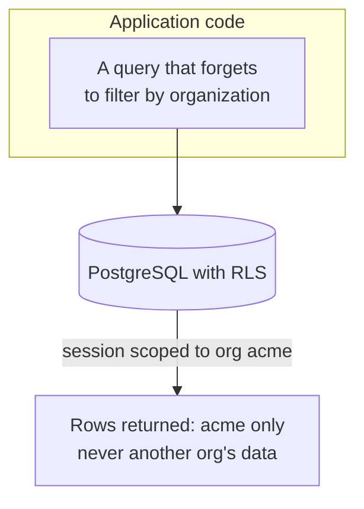

Every multi-tenant system has to answer the same question: what stops a bug in organization A's code path from returning organization B's data? The conventional answer is discipline: every query gets a `WHERE org_id = ?` clause, added by convention, reviewed in code review, hopefully never forgotten.

We didn't want the answer to be discipline. We wanted it to be a database property that doesn't care whether the application code remembered.

{/* truncate */}

## Where the application-level approach breaks

`WHERE org_id = ?` is a pattern, not a guarantee. It's only as strong as the least careful query in the codebase: one join that forgets the clause, one raw SQL escape hatch, one new engineer who doesn't know the convention yet. When it breaks, it doesn't throw an error. It just quietly returns rows that belong to someone else's organization. That's close to the worst possible failure mode for a security bug: silent, and only discovered when someone notices data that shouldn't be there.

## What row-level security changes

PostgreSQL's row-level security (RLS) moves the boundary into the database itself. Every table that holds organization-scoped data has a policy that filters rows based on the organization the database session was opened for, set once at the start of the session, before any query runs.



The critical property: a query that forgets to filter by organization doesn't leak the wrong rows. It returns *no* rows for anything outside its session's scope, because the database enforces the boundary independently of what the query asked for. The failure mode changes from "silently wrong" to "safely empty", which is the difference between a data breach and a bug report.

## One boundary for every code path

The guarantee holds when every path that touches the database runs inside a session scoped to an organization. In OpenProxyAI that includes the request path and also the work that happens outside it: log archival, webhook retries and scheduled analytics refreshes each open their own scoped session. The result is a boundary that holds everywhere, not just in the code paths someone thought to test.

## Try it

```bash
git clone https://github.com/Rayyan-Oumlil/OpenProxyAI
cd OpenProxyAI
docker compose -f docker-compose.demo.yml up --build
```

Needs Docker and no provider key. The console is at http://localhost:5173. If tenant isolation by construction matters to you, star the repo or open an issue. More on the policy mechanics in [Row-Level Security](/security/row-level-security).

These statements are based on OpenProxyAI's behavior at the post date.
