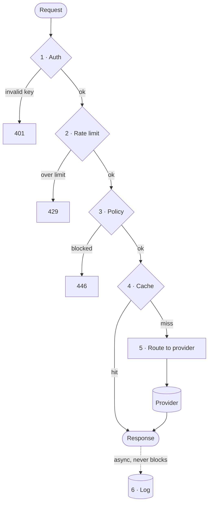

"Adds a few milliseconds of overhead" is the kind of line that shows up in every proxy's marketing copy. It undersells what is happening in that window. Six things happen, in a specific order, and the order is load-bearing: get it wrong and you either serve a cached answer to a request that policy should have refused, or you pay for cache infrastructure you cannot actually use.

{/* truncate */}

## The pipeline



## Why the order is not arbitrary

**Auth and rate limiting come first** because there is no point doing any other work, such as scanning for personal data or checking a cache, for a request you are about to reject anyway. Reject cheap failures as early as possible.

**Policy runs before cache, not after.** This is the one that matters. If the cache check came first, a request that your policy would block could be answered from an entry stored before the rule existed, and the block would never happen. Running policy first means a refused request never reaches the cache or a provider. When policy is enforcing, a request containing personal data is refused outright rather than rewritten, so it is never stored.

**Cache comes before routing** for the obvious reason: a cache hit means there is no routing decision to make at all. The request never reaches provider selection, because it never reaches a provider.

**Logging is the only stage that happens after the response is sent.** Every other stage can reject or delay the request. Logging cannot: it is written asynchronously once the response has already gone back to the caller, so a slow logging backend is never the reason your application's request takes longer.

## What this costs in practice

The checks before and after the provider call are small next to the provider round-trip itself, which dominates the time your users wait. A cache hit does not add latency at all. It replaces the provider round-trip entirely, which saves time and money instead of spending it.

The milliseconds are not overhead you pay for nothing. They are where policy checks, limits and cache correctness all happen in the right order, before the request goes anywhere you cannot take it back from.

## Try it

```bash
git clone https://github.com/Rayyan-Oumlil/OpenProxyAI
cd OpenProxyAI
docker compose -f docker-compose.demo.yml up --build
```

Needs Docker and no provider key. The console is at http://localhost:5173, where the request trace shows each request's path. If it is useful, star the repo or open an issue. Full detail on each stage is in [Request Pipeline](/core-concepts/request-pipeline).

These statements are based on OpenProxyAI's behavior at the post date.
