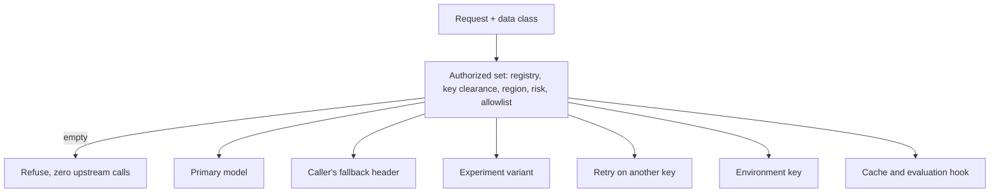

Say your policy is "customer health data may only go to models we have vetted for it." You build a router that picks an approved model for each request. It works. Then a provider has a bad minute, the gateway retries, and the retry goes to a cheaper model nobody approved. The router was correct and the policy was still broken.

{/* truncate */}

The mistake is treating "which model serves this request" as one decision. It is several, made at different times by different code. Every one of them has to obey the same rule, or the rule means nothing.

## The rule

**Work out the set of models that may serve this request once, up front. Everything after that, including every fallback, may only pick from that set. If the set is empty, refuse the request and call nobody.**

That is all of it. The rest of this post is the list of places where it is easy to forget.

## Six ways a request gets redirected

1. **The caller's own fallback.** A client can send a header naming a backup model. If you honor it blindly, any caller can aim restricted data at any model. Fix: check the backup against the same set. If it is not in it, ignore it and record why.
2. **A/B experiments.** An experiment says "send 10% of traffic to the new model." If the variant is not authorized for this request's class, it has to be dropped and the request served by the model the caller asked for. If neither is authorized, the request is refused.
3. **Retrying on another key.** A model should be served by the key it was registered with, not by any other key of the same provider that happens to be healthy. That other key may point at a different endpoint, region or account.
4. **The environment-key fallback.** Many gateways, when no stored key is found, fall back to a key in an environment variable. In an enforcing setup, that quietly bypasses the registry. It must not be reachable.
5. **The semantic cache.** A cached answer must never be served across data classes, so the cache key includes the class. And building the cache's embedding is itself a call to a model the registry does not govern. Above a chosen sensitivity, skip the semantic cache.
6. **The evaluation hook.** Sending a prompt and its response to a judge model is a call to another model. It needs the same gate.

None of these is exotic. Each one is a normal feature that someone added for a good reason.

## What closing them looks like here

In OpenProxyAI these are separate code paths with one shared decision behind them, and separate tests:

- The routing decision is a pure function. [Hypothesis](https://hypothesis.readthedocs.io/) property tests generate random registries, data classes, regions, risk ratings and allowlists, and check things like "the chosen route is always inside the authorized set and is never a substitute," "a more sensitive request never has more authorized models," and "lowering a key's clearance never adds a model."
- Pipeline tests cover each redirect above: an unauthorized fallback is dropped and the reason recorded, an unauthorized experiment variant is dropped, there is no fallback to an environment key when a registry key exists, and the cache and evaluation hook are skipped above a configurable ceiling.
- End-to-end tests run the real pipeline against a fake upstream, and a live smoke test asks the policy preview what would happen and then sends the real request, to make sure they agree.
- An empty set returns HTTP 446 before any upstream call.

## What this does not do

Honesty matters more than the claim:

- **It trusts the classifier.** The rule keeps a request inside the set that fits its data class. It does not make the class right. If the detector misses a sensitive value, the request is routed as if it were less sensitive. The built-in detector finds SSNs, payment cards and emails; a bare nine-digit number or a spelled-out email is not detected. Callers can raise a request's class with a header but never lower it.
- **The retry paths are not yet property-tested end to end.** The decision is tested with random inputs. Random upstream failures across every retry path is a test I would add next.
- **It only governs traffic that goes through it.** A gateway cannot stop someone calling a provider directly. That needs network controls too.

## Questions to ask any gateway

If you are evaluating one, these are worth five minutes:

1. When the primary fails, can the retry go to a model I did not approve for this data?
2. Can a caller choose its own fallback model? What checks it?
3. If no stored key is found, does it fall back to an environment key?
4. Does the cache or an evaluation hook make a call to a model I did not approve?
5. What happens when nothing is approved: an error, or a silent default?

If the answers are vague, the router may be correct and the policy still broken.
