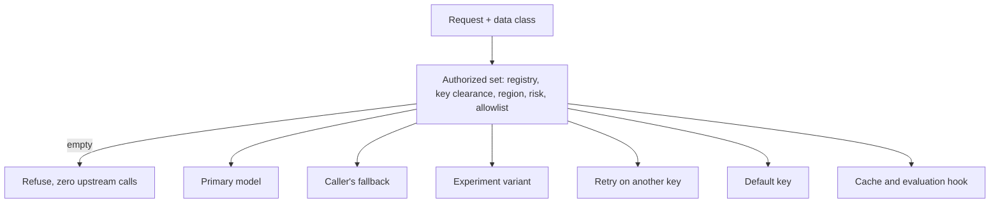

Say your policy is "customer health data may only go to models we have vetted for it." You build a router that picks an approved model for each request. It works. Then a provider has a bad minute, the gateway retries, and the retry goes to a cheaper model nobody approved. The router was correct and the policy was still broken.

{/* truncate */}

The mistake is treating "which model serves this request" as one decision. It is several, made at different times by different code. Every one of them has to obey the same rule, or the rule means nothing.

## The rule

**Work out the set of models that may serve this request once, up front. Everything after that, including every fallback, may only pick from that set. If the set is empty, refuse the request and call nobody.**

That is all of it. The rest of this post is the list of places where it is easy to forget.

## Six ways a request gets redirected



1. **The caller's own fallback.** A client can name a backup model. If a gateway honors it blindly, any caller can aim restricted data at any model. The safe behavior is to check the backup against the same set and ignore it, with a recorded reason, if it is not in it.
2. **A/B experiments.** An experiment says "send 10% of traffic to the new model." If the variant is not authorized for this request's class, it is dropped and the request is served by the model the caller asked for. If neither is authorized, the request is refused.
3. **Retrying on another key.** A model should be served by the key it was registered with, not by any other key of the same provider that happens to be healthy. That other key may point at a different endpoint, region or account.
4. **The default-key fallback.** Many gateways, when no stored key is found, reach for a key configured somewhere else. In an enforcing setup, that would quietly bypass the registry, so it must not be reachable.
5. **The semantic cache.** Building a cache embedding is itself a call to a model, and a stored answer can be served to someone other than the person it was made for. Above a chosen sensitivity, the semantic cache is skipped. See [A semantic cache is shared memory](/blog/semantic-cache-is-shared-memory) for how matching works.
6. **The evaluation hook.** Sending a prompt and its response to a judge model is a call to another model. It needs the same gate.

None of these is exotic. Each one is a normal feature that someone added for a good reason.

## How OpenProxyAI keeps them closed

OpenProxyAI makes one routing decision per request and every redirect above answers to it:

- With routing set to enforce, a request is served only by a registered model that is cleared for its data class, region and risk limit, through the key that model was registered with.
- A caller-supplied fallback that is not in the authorized set is dropped, and the reason is recorded.
- An experiment variant outside the set is dropped in favor of the model the caller asked for.
- The semantic cache and evaluation hook are skipped above a data-class ceiling you configure.
- If nothing is authorized, the request returns HTTP 446 before any provider is called.

The routing decision is checked with randomized tests over many combinations of registries, data classes, regions, risk ratings and allowlists, on top of end-to-end runs through the whole pipeline. The properties they hold to are simple: a more sensitive request never has more authorized models, and lowering a key's clearance never adds one.

## Good to know

A caller can raise a request's data class with a header, never lower it, so applications that know more than the detector can always tighten the rules for a request.

## Questions to ask any gateway

If you are evaluating one, these are worth five minutes:

1. When the primary fails, can the retry go to a model I did not approve for this data?
2. Can a caller choose its own fallback model? What checks it?
3. If no stored key is found, does it fall back to some other key?
4. Does the cache or an evaluation hook make a call to a model I did not approve?
5. What happens when nothing is approved: an error, or a silent default?

If the answers are clear, your router and your policy agree.

## Try it

The demo runs with Docker and needs no provider key. Console at http://localhost:5173.

```bash
git clone https://github.com/Rayyan-Oumlil/OpenProxyAI
cd OpenProxyAI
docker compose -f docker-compose.demo.yml up --build
```

If it is useful, star the repo or open an issue with the redirect paths you want covered.

See [Provider routing](/core-concepts/provider-routing) and [Policies and guardrails](/core-concepts/policies-and-guardrails).

These statements are based on OpenProxyAI's behavior at the post date.
