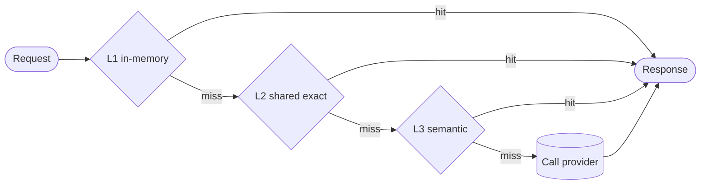

# Caching

OpenProxyAI can answer a repeated chat request from a cache instead of calling the provider. There are two kinds of match: an **exact** match (same organization, model, messages and temperature) and a **semantic** match (a differently worded prompt whose meaning is close enough to a stored one). Both are off by default and are switched on by the operator. This page covers how each tier works, what is never cached, how to bypass the cache per request, and how to tune and debug it.

## How a lookup works

Tiers are checked in order and the first hit wins. Only non-streaming chat completions use the cache.



A request reaches the cache only after the policy and routing checks have passed. A request that policy blocks never reaches the provider, so it is never stored.

| Tier | Match | Scope | Switch (operator) | Defaults |
|---|---|---|---|---|
| L1 | Exact | One proxy process | `SEMANTIC_CACHE_ENABLED` | 1,000 entries, 300 s (`SEMANTIC_CACHE_L1_MAX_SIZE`, `SEMANTIC_CACHE_L1_TTL_SECONDS`) |
| L2 | Exact | Every proxy instance, survives restarts (Redis) | `CACHE_ENABLED` | 3,600 s (`CACHE_TTL_SECONDS`) |
| L3 | Semantic | Every proxy instance (Postgres vector search) | `SEMANTIC_CACHE_ENABLED` | Similarity 0.95 (`SEMANTIC_CACHE_SIMILARITY_THRESHOLD`) |

Two details are easy to miss. L1 is only active when `SEMANTIC_CACHE_ENABLED` is on, so `CACHE_ENABLED` alone gives you L2 only. A hit in L2 or L3 also fills L1 on that instance. Stored answers expire after `CACHE_TTL_SECONDS`, including L3 entries.

### Exact cache

The key is a hash of the organization, model, messages and temperature. Two requests that differ in any of those do not share an entry, and organizations never share entries.

### Semantic cache

The prompt text is turned into an embedding and compared by cosine similarity with stored prompts. The best match is used if its similarity is at least the threshold. A match must belong to the same organization and the same model, and must not have expired. Temperature is not part of the semantic match.

Semantic matching pays off on high-volume, templated traffic where the same question arrives in many wordings: support replies, summaries of similar documents, repeated internal Q&A. It does little for one-off requests. A semantic hit is an approximation, so a prompt that differs in one important detail can receive the answer to its neighbor. Use the bypass header for requests where that is unacceptable.

The semantic cache needs an embedding endpoint. The operator sets `SEMANTIC_CACHE_EMBEDDING_API_KEY` or `SEMANTIC_CACHE_EMBEDDING_API_BASE` (and optionally `SEMANTIC_CACHE_EMBEDDING_MODEL`, default `text-embedding-3-small`). With neither set, L3 is skipped and no error is raised. Prompts go only to that configured endpoint.

## What is not cached

| Case | Why |
|---|---|
| Streaming requests | The cache is only consulted for non-streaming responses |
| Requests with `tools`, `functions`, `tool_choice`, `function_call` or `response_format`, or with tool messages in the history | The key ignores these fields, so two different requests could receive each other's answer |
| Requests where a [behavior setting](/core-concepts/behavior-settings) changes more than temperature | The key would not reflect the change |
| Requests blocked by policy or routing | They never reach the provider |
| Semantic tier only: air-gapped deployments | Prompts must not leave for an embedding endpoint |
| Semantic tier only: organizations whose data region is not in `SHARED_KEY_REGIONS` (default `us,global`) | The shared embedding endpoint has no region tag. See [Data residency](/security/data-residency) |
| Semantic tier only: requests above `OFF_REGISTRY_MAX_DATA_CLASS` (default `internal`) while `routing_mode` is `enforce` | The embedding endpoint is not governed by the model registry |

In the last three cases the exact tiers still work. When response guardrails are enabled, they run before an answer is stored, so a stored answer is the one the caller saw. With the policy in `log_only` or `off`, a prompt containing personal data is cached as sent. See [what a cache hit is matched on](/blog/semantic-cache-is-shared-memory).

## Bypassing the cache per request

Send `x-openproxy-cache` on the request:

```bash
curl https://your-gateway/v1/chat/completions \
  -H "Authorization: Bearer $OPENPROXY_KEY" \
  -H "x-openproxy-cache: skip" \
  -H "Content-Type: application/json" \
  -d '{"model":"openai/gpt-4o","messages":[{"role":"user","content":"What is our refund window?"}]}'
```

| Value | Reads the cache | Writes the cache |
|---|---|---|
| (absent) | Yes | Yes |
| `skip` | No | No |
| `no-store` | Yes | No |
| `no-cache` | Accepted, but currently behaves like no header | Yes |

Any other value is ignored. The response carries `X-OpenProxyAI-Cache` with `hit:exact`, `hit:semantic` or `miss`; it is absent when the cache is off. A cache failure never blocks the request: the gateway logs a warning and calls the provider.

## Measuring it

```bash
curl "https://your-gateway/api/v1/analytics/cache?period_days=7" \
  -H "Authorization: Bearer $OPENPROXY_KEY"
```

```json
{
  "period_days": 7,
  "exact_hits": 0,
  "semantic_hits": 0,
  "misses": 0,
  "hit_rate": 0.0,
  "estimated_savings_usd": 0.0
}
```

`period_days` is 1 to 90 (default 7). The same numbers appear on the admin console dashboard. Each request log also records `cache` as `hit:exact`, `hit:semantic` or `miss`.

## Tuning the semantic threshold

The threshold is one value for the whole deployment, so tune it against your most sensitive traffic, not your average.

| Goal | Change |
|---|---|
| Fewer wrong answers from near-miss prompts | Raise `SEMANTIC_CACHE_SIMILARITY_THRESHOLD` toward 1.0 |
| More hits on reworded prompts | Lower it gradually, and review hits in the request log after each change |
| Fresh answers for specific calls | Send `x-openproxy-cache: skip` on those calls |
| Shorter staleness | Lower `CACHE_TTL_SECONDS` |

A threshold of 1.0 leaves the semantic tier matching only identical embeddings, which in practice means exact text.

## Troubleshooting

| Symptom | Likely cause | Fix |
|---|---|---|
| `X-OpenProxyAI-Cache` never appears | Both cache switches are off | Set `CACHE_ENABLED` and/or `SEMANTIC_CACHE_ENABLED` |
| Identical prompts always miss | Different temperature, model or organization; or the request uses tools or `response_format` | Keep temperature fixed; see the table of what is not cached |
| Identical prompts miss on a second instance | Only L1 is on, and L1 is per process | Turn on `CACHE_ENABLED` for the shared tier |
| Reworded prompts never hit | No embedding credentials, air-gapped mode, organization region outside `SHARED_KEY_REGIONS`, or an enforced request above the data-class ceiling | Set embedding credentials; check region and `routing_mode` |
| A semantic hit returned the wrong answer | Threshold too low for this traffic | Raise it, or bypass with `skip` |
| An answer is out of date | Entry still inside its TTL | Send `skip`, or lower `CACHE_TTL_SECONDS` |
| Streaming calls never hit | Streaming is not cached | Use non-streaming for cacheable calls |

## Next steps

- [Request pipeline](/core-concepts/request-pipeline) shows where the cache check sits.
- [Policies and guardrails](/core-concepts/policies-and-guardrails) explains what runs before an answer is stored.
- [Environment flags](/getting-started/environment-flags) lists every cache variable.
- [Chat completions](/api-reference/chat-completions) documents the request headers.
